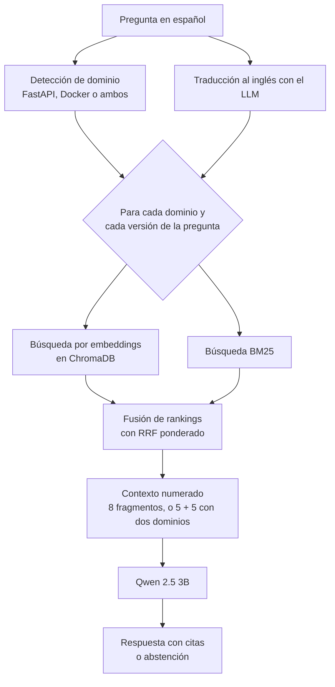

# DevDocsRAG

Asistente local que responde en español preguntas sobre la documentación oficial de
**FastAPI** y **Docker**, citando los fragmentos de la documentación en los que se apoya.
Funciona por completo en el equipo del usuario: el modelo de lenguaje se ejecuta con
[Ollama](https://ollama.com) y la documentación se indexa en una base vectorial local.

- Responde con citas numeradas a fragmentos de la documentación oficial.
- Detecta si la pregunta trata de FastAPI, de Docker o de ambas, y busca en la
  documentación correspondiente.
- Combina búsqueda semántica con embeddings multilingües y búsqueda por términos
  exactos con BM25.
- Reconoce cuando la documentación no cubre la pregunta en lugar de inventar una respuesta.
- Incluye una interfaz web, herramientas de terminal y un banco de evaluación con 30
  preguntas.

## Ejemplo

```text
> python -m src.ask "¿Qué hacen las instrucciones FROM, WORKDIR, COPY, RUN y CMD de un Dockerfile?"

RESPUESTA:
Las instrucciones de un Dockerfile son:
- `FROM`: Selecciona la imagen base en la que se construirá el contenedor. [1]
- `WORKDIR`: Establece la carpeta dentro de la imagen donde las instrucciones siguientes se aplicarán. [1]
- `COPY`: Copia archivos desde el proyecto al contenedor. [1]
- `RUN`: Ejecuta una instrucción durante la construcción de la imagen, como la instalación de paquetes. [1]
- `CMD`: Establece el comando por defecto que se ejecutará cuando se inicie el contenedor. [1]

FUENTES RECUPERADAS:
[1] [docker] Write your first Dockerfile | docker_write_dockerfile.md | chunk_00308 | https://docs.docker.com/learn/content/write-your-first-dockerfile/
[2] [docker] Image layers and the build cache | docker_build_cache.md | chunk_00335 | https://docs.docker.com/learn/content/how-image-layers-and-the-build-cache-work/
...
```

## Inicio rápido

Requisitos: Python 3.11 o 3.12, [Ollama](https://ollama.com/download) y unos 3 GB libres.

```powershell
git clone https://github.com/Vilval25/DockerRAG.git
cd DockerRAG
py -3.12 -m venv .venv
.venv\Scripts\Activate.ps1          # en Linux o macOS: source .venv/bin/activate
pip install -r requirements.txt
ollama pull qwen2.5:3b
python -m src.ingest                # crea el índice local a partir del corpus
streamlit run app.py                # abre la interfaz web
```

La primera ejecución de `src.ingest` descarga el modelo de embeddings y tarda un par de
minutos. El índice (`chroma_db/`) no se versiona: se genera a partir del corpus incluido en
el repositorio y produce siempre los mismos fragmentos.

Si la consola de Windows muestra caracteres extraños, ejecuta `$env:PYTHONUTF8 = "1"`.

## Uso

### Interfaz web

```powershell
streamlit run app.py
```

Permite escribir la pregunta, elegir si se consulta la documentación de FastAPI, la de
Docker o se detecta automáticamente, y activar o desactivar la recuperación para comparar
con el modelo sin RAG. Bajo la respuesta se muestran los fragmentos recuperados con su
enlace a la página oficial.

### Terminal

```powershell
python -m src.ask "¿Cómo publico un puerto con Docker?"          # pregunta con RAG
python -m src.ask --base "¿Cómo publico un puerto con Docker?"   # mismo modelo sin RAG
python -m src.ask --domain fastapi "¿Cómo funcionan las dependencias?"
python -m src.search "¿Qué hace EXPOSE?"                         # solo muestra los fragmentos recuperados
python -m src.search --full --domain docker "volúmenes con nombre"
```

`src.search` no llama al modelo generador para responder: sirve para inspeccionar qué
fragmentos llegarían al contexto.

## Cómo funciona



1. **Detección de dominio.** Patrones de la pregunta, como los nombres de las tecnologías
   o términos como dockerfile, volumen o compose, deciden si se busca en la documentación
   de FastAPI, en la de Docker o en ambas.
2. **Expansión de la consulta.** El modelo traduce la pregunta al inglés, el idioma de la
   documentación, y se buscan las dos versiones.
3. **Búsqueda híbrida.** Cada versión se busca por similitud de embeddings
   (`paraphrase-multilingual-MiniLM-L12-v2`) y por coincidencia de términos con BM25. Los
   rankings se combinan con Reciprocal Rank Fusion ponderado.
4. **Generación fundamentada.** El modelo recibe los fragmentos numerados y unas
   instrucciones que le exigen usar solo esa información, citar cada afirmación, decir
   qué parte no está documentada, abstenerse cuando ningún fragmento se relaciona con la
   pregunta y corregir las premisas falsas.

## Configuración

Los parámetros se leen de variables de entorno, con los valores del sistema evaluado por
defecto. Por ejemplo, en PowerShell: `$env:OLLAMA_MODEL = "qwen2.5:7b"`.

| Variable | Valor por defecto | Descripción |
|---|---|---|
| `OLLAMA_MODEL` | `qwen2.5:3b` | Modelo generador de Ollama |
| `OLLAMA_BASE_URL` | `http://localhost:11434` | Dirección del servidor de Ollama |
| `EMBEDDING_MODEL` | `sentence-transformers/paraphrase-multilingual-MiniLM-L12-v2` | Modelo de embeddings; cambiarlo exige volver a ejecutar `src.ingest` |
| `RETRIEVAL_K` | `8` | Fragmentos entregados al modelo cuando la pregunta es de un solo dominio |
| `INTEGRATED_K_PER_DOMAIN` | `5` | Fragmentos por dominio cuando la pregunta involucra ambos |
| `QUERY_EXPANSION_ENABLED` | `true` | Busca también la traducción de la pregunta al inglés |
| `QUERY_EXPANSION_SEARCH_K` | `10` | Candidatos por búsqueda, dominio y versión de la pregunta |
| `HYBRID_SEARCH_ENABLED` | `true` | Añade la búsqueda BM25 a la búsqueda por embeddings |
| `BM25_WEIGHT` | `1.5` | Factor que multiplica el peso de la búsqueda BM25 en la fusión |
| `RRF_CONSTANT` | `60` | Constante de Reciprocal Rank Fusion |
| `RRF_ORIGINAL_QUERY_WEIGHT` | `1.0` | Peso de la pregunta original en la fusión |
| `RRF_EXPANDED_QUERY_WEIGHT` | `0.75` | Peso de la pregunta traducida en la fusión |

## Corpus

El corpus reúne 23 páginas oficiales, 13 de Docker y 10 de FastAPI, divididas en 573
fragmentos de hasta 800 caracteres. Está en [`data/documentos/`](data/documentos/), junto
con un `manifest.json` que registra la dirección y la fecha de descarga de cada página.

```powershell
python -m src.download_docs   # vuelve a descargar y limpiar las páginas
python -m src.ingest          # vuelve a crear el índice
```

La documentación oficial cambia con frecuencia, por lo que volver a descargarla produce un
corpus distinto al evaluado, que corresponde a la descarga del 25 de noviembre de 2026.

## Estructura del repositorio

```text
app.py                     interfaz web (Streamlit)
src/
  config.py                parámetros del sistema
  download_docs.py         descarga y limpieza de la documentación
  ingest.py                fragmentación, embeddings e indexación en ChromaDB
  rag.py                   detección de dominio, búsqueda híbrida, RRF, instrucciones y generación
  ask.py                   consultas desde la terminal
  search.py                inspección de la recuperación
data/documentos/           corpus en Markdown y manifest.json
evaluation/                banco de preguntas, scripts de evaluación, rúbrica y resultados
docs/informe/              informe del proyecto (cuaderno Jupyter)
```

## Evaluación

El sistema se evaluó comparando las respuestas del mismo modelo sin RAG y con RAG sobre un
banco de 30 preguntas, separadas en un conjunto de desarrollo y uno de prueba. En las 15
preguntas del conjunto de desarrollo, según la calificación de consenso de tres
evaluadores:

| Métrica | Sin RAG | Con RAG |
|---|---:|---:|
| Respuestas fundamentadas en la documentación | 0 de 15 | 9 de 15 |
| Respuestas con contenido no respaldado | 15 de 15 | 6 de 15 |
| Respuestas correctas y completas | 3 de 15 | 8 de 15 |

El banco de preguntas, la rúbrica, los scripts y la guía para repetir la evaluación están
en [`evaluation/`](evaluation/). El análisis completo, incluidos los errores del sistema y
sus limitaciones, está en el
[informe](docs/informe/solPE2_Jefferson-Rojas_Juan-Tocto_Andre-Valenzuela_Gustavo-Vila.ipynb).

## Equipo

Grupo 3 del Proyecto Equipo N.º 2 del curso Sistemas Inteligentes, Universidad Nacional
Mayor de San Marcos, semestre 2026-2, sección 3: Jefferson Rojas, Juan Tocto, Andre
Valenzuela y Gustavo Vila.
